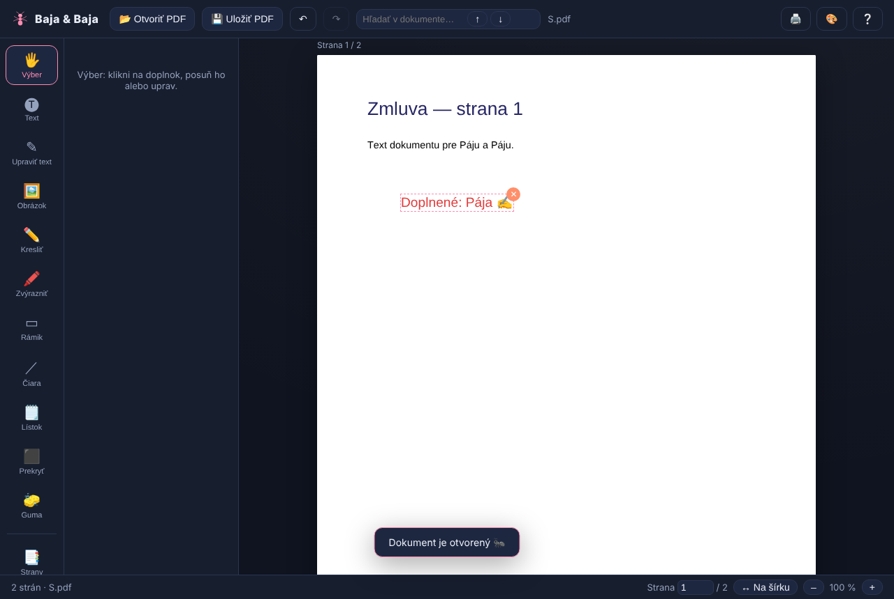

# Baja & Baja 🐜 — PDF dielnička

Súkromná PDF appka pre dvoch. Jeden HTML súbor, otvorí sa dvojklikom, funguje offline,
nič neinštaluje a nepotrebuje administrátora.

**Hotový súbor na poslanie:** [`dist/BajaBaja.html`](dist/BajaBaja.html)
**Návod pre používateľov:** [`docs/NAVOD.md`](docs/NAVOD.md)



## Čo vie
Zobraziť a prehľadávať PDF · pridať text (plná SK/CZ diakritika), obrázky, kresby,
zvýraznenia, tvary a poznámky · strany (otočiť, zmazať, poradie, spojiť, rozdeliť) ·
vyplniť formuláre · OCR (SK/CZ/EN) · konverzie PDF↔obrázky, PDF→text, PDF→Word,
obrázky→PDF, zmenšenie, vyčistenie údajov o dokumente.

Appka do dokumentu **pridáva** vlastné doplnky a spravuje strany/formuláre/konverzie.
Needituje pôvodný text vysádzaný v súbore (na to slúži PDF→Word a úprava vo Worde).

## Vývoj
```bash
cd ant
npm install
node scripts/copy-assets.mjs   # pripraví offline súbory do public/vendor
node scripts/build-html.mjs    # poskladá dist/BajaBaja.html
```
Testy (headless prehliadač): `node scripts/test.mjs`, `verify2.mjs`, `verify3.mjs`.

## Použité knižnice
pdf.js, pdf-lib, @pdf-lib/fontkit, tesseract.js, fflate, DejaVu fonts — všetko vložené
priamo do výsledného HTML, žiadny server ani externé volania (okrem prvého stiahnutia
OCR jazykov).
